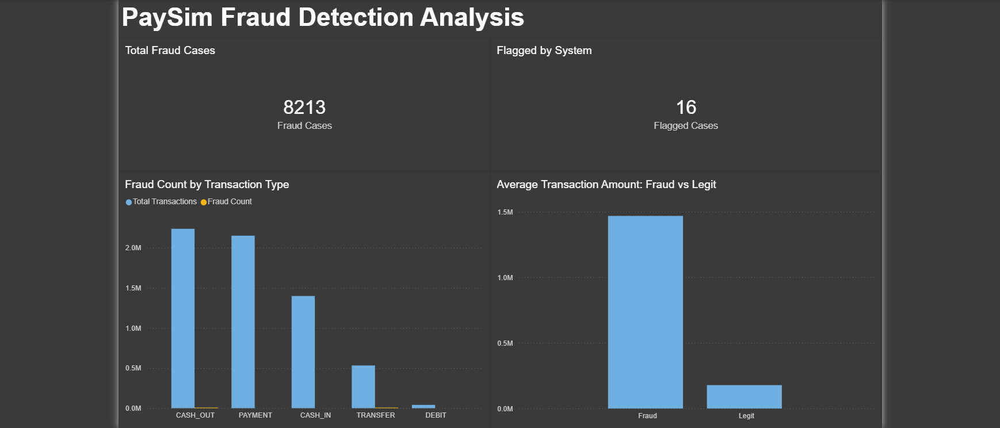

# PaySim Fraud Detection Analysis

I built this project to practice SQL and Power BI on a realistic fraud-detection problem: ~6.4 million synthetic mobile money transactions. The goal was to find fraud patterns and test how well the dataset's own fraud flag performs. Power BI doesn't have a native SQLite connector, so I used a small Python script (pandas + sqlite3) to bridge the two. Details are in the tooling note below.

## Dataset

[PaySim](https://www.kaggle.com/datasets/ealaxi/paysim1) - a synthetic dataset simulating mobile money transactions, built to resemble real financial fraud. 6,362,620 rows, 11 columns. Because the data is simulated, my results describe this dataset, not real-world fraud (see Limits).

## Tools I Used

- **SQLite** - local database
- **DBeaver** - SQL client for exploration and cleaning
- **Python** (pandas, sqlite3) - connected Power BI to the database (see the tooling note below for why)
- **Power BI Desktop** - the dashboard
- **LibreOffice Calc** - a pivot table summary artifact

## Questions I Asked

The queries in `queries.sql` are grouped by the question each one answers:

- **A. Is the data clean?** Queries 1-5, plus follow-up checks 4b and 4c
- **B. How common is fraud?** Query 6
- **C. How well does the built-in fraud flag work?** Queries 7-8
- **D. What does fraud look like, by transaction type and amount?** Queries 9-12

## Data Cleaning

Before analyzing anything, I checked (query numbers in brackets):

- Row count matches the known source size, 6,362,620 (Q1)
- 0 null values across all 11 columns (Q2)
- 5 valid transaction types, no unexpected categories (Q3)
- No negative amounts and every amount stored as a number, but 16 rows have an amount of exactly 0 (Q4)
- 0 exact duplicate rows (Q5)

**Zero-amount rows:** all 16 are `CASH_OUT`, all 16 are labeled fraud, and their balances don't change (Q4b, Q4c). I don't know why the simulation produces them. I left them in instead of deleting them, and I'm not treating them as a real-world pattern.

## What I Found

1. **Fraud rate:** 8,213 fraudulent transactions out of 6,362,620 total (~0.13%) (Q6)
2. **Built-in flag:** the `isFlaggedFraud` flag caught only 16 of the 8,213 fraud cases (~0.19% recall), so it missed about 99.8% of fraud. All 16 it flagged were real fraud (100% precision), so it is right when it flags but far too narrow to rely on alone (Q7-Q8)
3. **Fraud is type-restricted in this dataset:** fraud only happens in `CASH_OUT` and `TRANSFER` transactions, with zero fraud in `CASH_IN`, `DEBIT`, or `PAYMENT` (Q9)
4. **Amount skew:** fraudulent transactions average a higher amount than legitimate ones (Q10)

**One caveat worth flagging:** the largest fraud amounts stop at exactly 10,000,000, and 287 of the 8,213 fraud cases (3.5%) sit exactly at that maximum (Q11, Q12). I don't think this is a real pattern. It looks like a limit built into how the synthetic data was generated, so I'm not presenting it as a genuine finding. It likely understates amount-based results (average amounts, totals) at the top end, while the fraud rate, catch rate, and fraud-by-type counts are unaffected.

## Limits

- **Simulated data.** Findings describe this dataset, not real-world fraud. For example, fraud appearing only in two transaction types is a property of how the data was generated.
- **The flag is a simple built-in rule,** not a model I trained. I evaluated it, but I did not build a fraud detector.
- **Fraud is only ~0.13% of rows,** so overall accuracy would be misleading. That is why I looked at precision and recall instead.
- **No time analysis.** I did not analyze fraud over time (the `step` column).

## A Note on Tooling

Power BI doesn't have an official native connector for SQLite. The only SQLite ODBC driver I could find was hosted on a site with an outdated, flagged SSL certificate, so instead of installing unverified third-party software, I connected through Power BI's built-in Python script connector (pandas + sqlite3).

Full writeup of that decision, plus the bugs I hit along the way and how I fixed them, is in [`notes.md`](./notes.md).

## Repo Contents

- `queries.sql` - 12 SQL queries plus 2 follow-up checks (4b, 4c), grouped A to D as above
- `notes.md` - Technical decisions, issues encountered, and resolutions
- `data/` - Exported query results powering the dashboard (4 CSVs)
- `paysim_fraud_dashboard.pbix` - Power BI dashboard (4 visuals)
- `fraud_by_type_pivot.xlsx` - Pivot table summary
- `dashboard_screenshot.png` - Preview image of the finished dashboard

## Dashboard

4 visuals: fraud count by transaction type, two cards (total fraud cases and system-flagged cases), and average transaction amount (fraud vs. legitimate), laid out on one dashboard page with the findings noted directly on it.

## Future Improvements

- Dual-axis scaling on the type chart, so the fraud_count bars aren't visually dwarfed by the total-transaction bars
- Fraud over time, using the `step` column
- A balance consistency check: does the change in each account's balance match the transaction amount?
